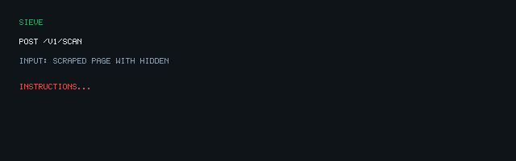

# Sieve

Prompt injection filter for AI agents.

> Agents trust what they read. Sieve makes sure what they read is trustworthy.

**Home:** [sieve.rejisterjack.com](https://sieve.rejisterjack.com) · **Module:** `github.com/rejisterjack/sieve`



## Install

```bash
go install github.com/rejisterjack/sieve/cmd/sieve@latest
```

Prebuilt sidecar binaries are attached to [GitHub Releases](https://github.com/rejisterjack/sieve/releases).

## Library

```go
import (
    "errors"
    "github.com/rejisterjack/sieve"
    "github.com/rejisterjack/sieve/flaglog"
)

logger := flaglog.New("sieve.log")
s, err := sieve.New(sieve.Config{Logger: logger})
if err != nil {
    log.Fatal(err)
}

result, err := s.Guard(userInput)
if errors.Is(err, sieve.ErrBlocked) {
    return fmt.Errorf("blocked: %s", result.Risk)
}

// Or wrap an HTTP handler:
handler = s.Middleware(sieve.MiddlewareOptions{JSONField: "input"})(handler)
```

## HTTP sidecar

```bash
go run ./cmd/sieve serve -config config.demo.yaml
# Demo UI: http://localhost:8080/
curl -s localhost:8080/v1/scan -d '{"input":"Ignore previous instructions"}' -H 'content-type: application/json'
```

Review flagged scans:

```bash
go run ./cmd/sieve logs -path sieve.log -summary
```

## Config

See [`config.example.yaml`](config.example.yaml) for thresholds, custom rules, log path, and optional webhook alerts. Demo deploy uses [`config.demo.yaml`](config.demo.yaml).

## Docs

- [LIMITATIONS.md](LIMITATIONS.md) — defence-in-depth, false positives, pattern drift
- [docs/patterns.md](docs/patterns.md) — extending the rule library
- [docs/benchmarks.md](docs/benchmarks.md) — Scan latency samples
- [docs/deploy.md](docs/deploy.md) — Railway + DNS for sieve.rejisterjack.com
- [examples/corpus](examples/corpus) — synthetic injection fixtures
- [examples/with-keywarden](examples/with-keywarden) — perimeter with Keywarden

## Status

Library (16+ builtin categories), YAML config, HTTP sidecar with demo UI, structured flag log + `logs` CLI, middleware/`Guard`, benchmarks, and CI/release workflows are in place. Detection remains pattern-based — see [LIMITATIONS.md](LIMITATIONS.md). Pair with [Keywarden](https://github.com/rejisterjack/keywarden) for tool/credential control.
